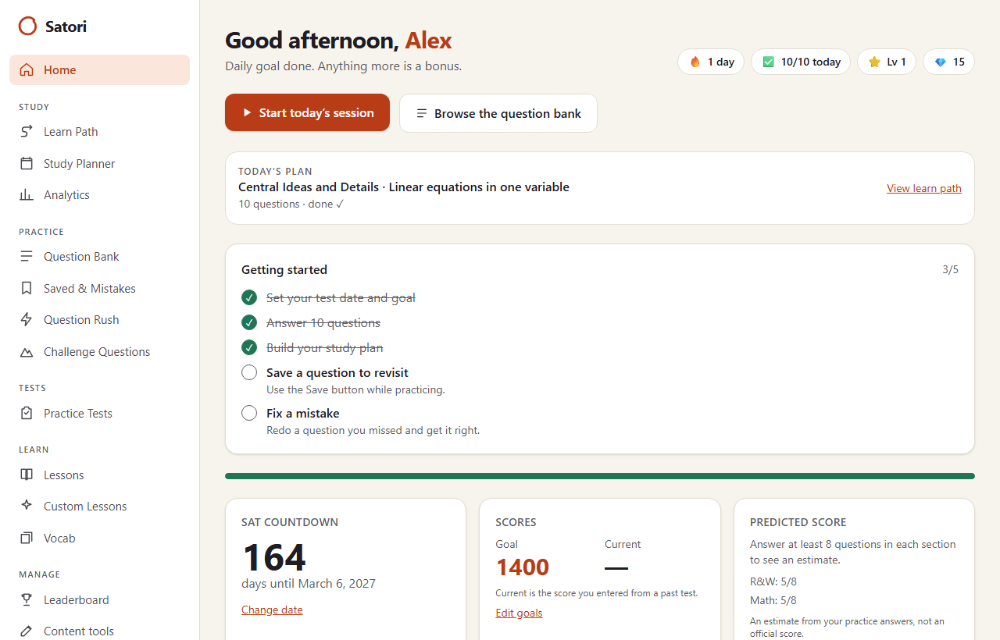
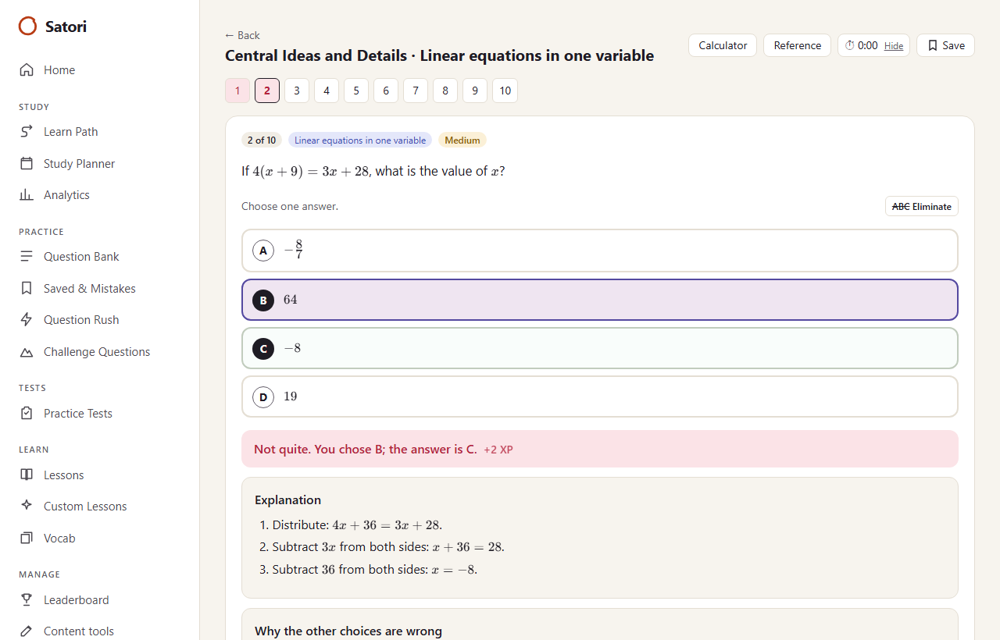
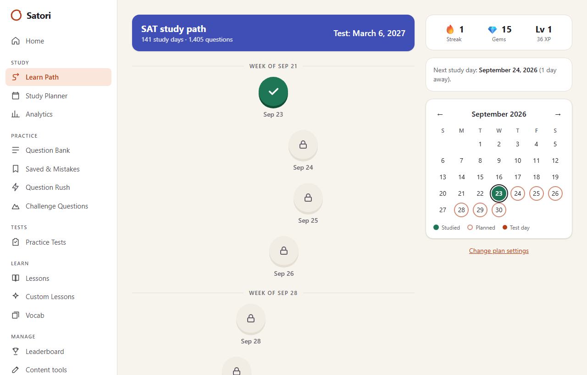
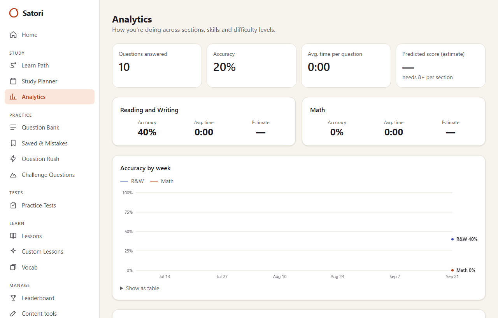

# Satori

**A free, open-source study app for the digital SAT that runs entirely on your own computer: no accounts, no payments, no cloud.**

Every question comes with a step-by-step explanation and a note on why each wrong choice is wrong. All questions are original: written for this project or produced by math template generators. None are copied from the College Board or any prep site.

> Scores shown in Satori are **estimates** from your practice answers, not official SAT scores. See [docs/SCORING.md](docs/SCORING.md).

| Home | Practice |
|---|---|
|  |  |
| **Learn path** | **Analytics** |
|  |  |

## Features

- **Study:** home dashboard with a test-date countdown and predicted score, a day-by-day study planner that rebuilds itself when you miss a day, a date-unlocked learn path with a calendar, and analytics by section, domain, skill and difficulty.
- **Practice:** filterable question bank, a practice player (multiple choice and grid-in, KaTeX math, answer eliminator, timer, Desmos calculator, reference sheet), Saved & Mistakes with "Redo my mistakes", Question Rush and Challenge Questions.
- **Tests:** full-length, section and single-module practice tests in the digital SAT format with adaptive module 2, a Bluebook-style interface and detailed score reports.
- **Learn:** a lesson for every skill, custom lessons built around your results, and 121 vocab words with spaced-repetition flashcards.
- **Profiles:** several local profiles (for example, siblings sharing a laptop) with a weekly leaderboard, plus backup and restore of the whole database.
- **Optional AI** (Claude or a free local Ollama model): a tutor that gives hints, and a question generator with an independent solve-check and a review queue. Everything else works without it.
- **Content:** 132 hand-written Reading & Writing questions, 64 hand-written Math questions, and 26 math generators (580 generated questions by default), each with its `source` and `license`. You can also import your own questions from JSON or CSV.

Light and dark mode, phone-width layouts, keyboard navigation and AA colour contrast throughout.

## Tech stack

Next.js 16 (App Router) · TypeScript · Tailwind CSS 4 · SQLite through Node's built-in `node:sqlite` · KaTeX · Vitest · Playwright. The AI features are optional and use the Anthropic SDK or Ollama.

## Prerequisites

- **Node.js 22.13 or later** (check with `node -v`). No native build tools are needed on Windows, macOS or Linux.
- Git.
- Optional: Docker, if you'd rather run it in a container.

## Install and run

```bash
git clone https://github.com/asoofy/satori.git
cd satori
npm install
npm run dev
```

Open http://localhost:3000. On first launch Satori creates `data/satori.db`, applies the migrations and loads the bundled questions automatically.

For a production build, run `npm run build` and then `npm start`. With Docker, run `docker compose up -d` (data is kept in the `satori-data` volume).

Satori has no login, so by default it only accepts connections from your own computer. To use it from another device on a network you trust, see [SECURITY.md](SECURITY.md).

| Command | What it does |
|---|---|
| `npm run dev` | Start in development mode |
| `npm run build` then `npm start` | Production build and server |
| `npm run seed` | Reload the bundled content. Your progress is kept |
| `npm test` / `npm run test:e2e` | Unit tests (Vitest) / Playwright smoke tests on a throwaway database |
| `npm run lint` / `npm run typecheck` | ESLint / TypeScript |

## Configuration

**No configuration is required.** To change anything, copy [`.env.example`](.env.example) to `.env.local` and uncomment what you need; each variable is explained there.

| Variable | Purpose |
|---|---|
| `SATORI_DB_PATH` | Where the SQLite file lives (default `data/satori.db`) |
| `ANTHROPIC_API_KEY` | Turns on the AI features with Claude (`SATORI_AI_MODEL` overrides the model) |
| `OLLAMA_URL`, `OLLAMA_MODEL` | Turns on the AI features with a free local model instead |
| `NEXT_PUBLIC_DESMOS_API_KEY` | Your own Desmos key (the public demo key is used otherwise) |
| `OPENSAT_URL` | Address of the optional OpenSAT importer |

With no AI configured, the tutor is hidden and the generator shows setup instructions. The Desmos calculator needs an internet connection; everything else works offline.

## Project structure

```
app/                  pages (App Router), server actions, route handlers
components/           UI: practice player, test runner, charts, calendar, Markdown + KaTeX
lib/                  database, grading, scoring, planner, test engine, AI, import/export
db/migrations/        plain SQL migrations, applied automatically on startup
content/              taxonomy, hand-written questions, math generators, lessons, vocab
scripts/              seed, e2e reset, screenshot capture
tests/                unit (Vitest) and e2e (Playwright) tests
docs/                 scoring model, content guide, screenshots
```

## Contributing

Contributions are welcome, especially original questions and new math generators. See [CONTRIBUTING.md](CONTRIBUTING.md). To report a security problem, see [SECURITY.md](SECURITY.md).

## License

- **Code:** [MIT](LICENSE).
- **Original content** (questions, explanations, generator text, lessons, vocabulary): [CC BY 4.0](LICENSE-CONTENT.md).
- Imported questions keep their own source and license.

Satori is not affiliated with or endorsed by the College Board. SAT is a trademark registered by the College Board.
